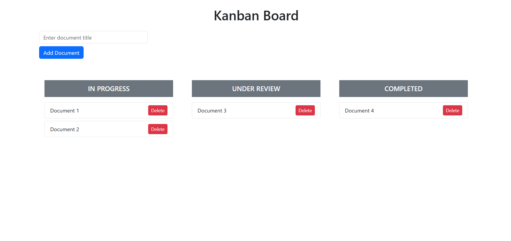

# Kanban Board

A small Kanban board for managing documents, built as a frontend test task (Hexlet x Habr Career challenge).

**Live demo:** https://kanban-board-mauve-kappa.vercel.app/



## Features

- Three columns: In Progress, Under Review, Completed
- Drag and drop documents between columns (react-dnd)
- Add new documents to "In Progress" and delete existing ones
- Board state managed with Redux Toolkit
- Card animations with Framer Motion

## Stack

Next.js (Pages Router), React, TypeScript, Redux Toolkit, react-dnd, Framer Motion, Bootstrap

## Run locally

```sh
git clone https://github.com/marymih/test-task-kanban.git
cd test-task-kanban
npm install
npm run dev
```

Then open http://localhost:3000.

## Possible next steps

- Persist the board in localStorage
- Filter documents by title across all columns
